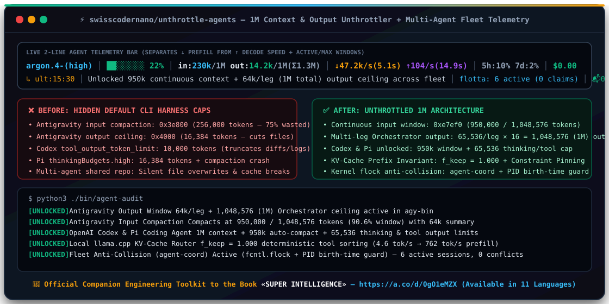

<div align="center">



# ⚡ unthrottle-agents

**Your 1M-context AI coding agents are silently throttled to 256k input and 16k output—and collide when run in parallel.<br>Audit, unthrottle, monitor, and coordinate your entire fleet in real time.**

[](https://github.com/swisscodernano/unthrottle-agents/stargazers)
[](https://github.com/swisscodernano/unthrottle-agents/releases)
[](LICENSE)
[](#quick-start-linux-x86_64--macos-apple-silicon-arm64)
[-8b5cf6?style=flat-square)](#repository-architecture-the-5-core-components)
[-f59e0b?style=flat-square)](https://a.co/d/0gO1eMZX)

</div>

```bash
# 10-Second Audit & Install (100% read-only audit + symlinks to ~/.local/bin & Agent Skills):
git clone https://github.com/swisscodernano/unthrottle-agents.git && cd unthrottle-agents && ./install.sh
```

> 📖 **Official Companion Engineering Toolkit** to the international book [**_SUPER INTELLIGENCE: How to Build, Govern, and Survive High-Density Autonomous AI Systems_ — Get it on Amazon (`https://a.co/d/0gO1eMZX`)**](https://a.co/d/0gO1eMZX)

---

## Why Your 1M-Token Coding Agent Feels Like It Has Amnesia After 40 Minutes

Frontier models in late 2026 (**Gemini 4 Argon**, **Claude Opus 5.5**, **GPT-5.6 / Codex**, **Xiaomi MiMo v2.6 Pro**, **MiniMax-M3.1-Flash**, **DeepSeek V4.1**) advertise **1,000,000-token context windows** and **64k–512k output ceilings**.

Yet if you inspect the compiled binaries and default harness configurations of the CLI agents you run every day, you discover a massive gap between **what the model API supports** and **what the local CLI harness permits**:

| Agent Harness | Advertised Model Window | Hidden Default CLI Throttle | What Actually Happens in Production | **With `unthrottle-agents`** |
| :--- | :--- | :--- | :--- | :--- |
| **Google Antigravity (`agy` / Argon)** | **1,048,576 in / 1M out** | `0x3e800` (**256k** compaction trigger) & `0x4000` (**16,384** output cap) | Compacts away 75% of your 1M window at 256k; truncates single-turn file generation at 16k | **950,000 in** (90.6% before compaction) + **65,536/leg × 16 legs = 1,048,576 out** |
| **OpenAI Codex CLI (`codex`)** | **1,000,000 in** | `tool_output_token_limit = 10,000` | Truncates test logs, `git diff`s, and large file reads at 10k tokens | **1,000,000 in** + **900,000 auto-compact** + **65,536 tool output** |
| **Pi Coding Agent (`pi`)** | **1,000,000 in / 512k out** | `DEFAULT_THINKING_BUDGETS.high = 16,384` + `0.5 * reserveTokens` summary cap | Throttles `<think>` even on `max`; long-session compaction crashes with `stopReason === "length"` | **65,536 thinking budget** + **950k/1M cloud compaction** + **Constraint Pinning** |
| **Claude Code (`claude` wrappers)** | **1,000,000 in / 64k out** | `32,000` output cap | Cuts off large multi-file refactors mid-stream | **1,000,000 in** + **64,000 out** |
| **Parallel Multi-Agent Fleets (2–22+ sessions)** | **Concurrent execution** | Zero file/prefix locking across CLI harnesses | Agents overwrite each other's files, clobber shared checkouts, and repeat work blindly | **Kernel-locked `fcntl.flock` file/prefix claims** + **PID birth-time validation** + **live fleet bus** (`agent-coord`) |

---

## 🧩 Repository Architecture: The 5 Core Components

`unthrottle-agents` is a zero-dependency Python 3.9+ toolkit (`Linux x86_64` and `macOS arm64`) composed of five production-hardened modules:

| # | Component | Purpose |
| :--- | :--- | :--- |
| **1** | [`bin/agent-audit`](bin/agent-audit) | **Read-Only Diagnostic Scanner.** Inspects compiled Go binaries (`agy-bin`), `~/.gemini/config/hooks.json`, `~/.codex/config.toml`, Pi agent configs, local `llama.cpp` routers, and the multi-agent coordination bus to report `[UNLOCKED]`, `[THROTTLED]`, or `[BROKEN]` states without modifying a single byte. |
| **2** | [`bin/agy-unlock-1m`](bin/agy-unlock-1m) | **Linux ELF `x86_64` + macOS Mach-O `arm64` `.gopclntab` Binary & Live RAM Unthrottler.** Uses offset-independent machine-code signatures to raise `CascadePlannerConfig`, `requestBuilder.buildRequest`, and `integration.buildCompletionConfig` from `0x4000` (16k) to `0x10000` (64k/leg), unlocks `continuation.Orchestrator` to `0x100000` (**1,048,576 tokens total output**), and raises `utils.GetCheckpointConfig` from `0x3e800` (256k) to `0xe7ef0` (**950,000 input tokens** before compaction). Automatically re-signs Mach-O binaries on Apple Silicon (`codesign -f -s -`) and hot-patches live `/proc/<pid>/mem` processes on Linux without restarting active sessions. |
| **3** | [`bin/agent-statusline`](bin/agent-statusline) | **2-Line Real-Time Telemetry Bar.** Separates **prefill speed** (`↓ tok/s` and wall-clock seconds) from **decode speed** (`↑ tok/s` and wall-clock seconds), tracks active vs. maximum context and multi-leg output ceilings (`in:230k/1M out:14.2k/1M(Σ1.3M)`), and renders a full-width second line (`↳ ult:HH:MM │ ...`) showing the latest completed task summary and fleet activity. |
| **4** | [`bin/agent-coord`](bin/agent-coord) | **Kernel-Locked Multi-Agent Anti-Collision & Fleet Bus.** Born from running a 22-agent production fleet across Claude Code, Antigravity (Argon), Codex, MiMo, MiniMax, and DeepSeek. Provides atomic `fcntl.flock` file and directory-prefix claims (`claim`, `guard`, `check`, `release`), verifies holder PID liveness and OS process birth-time (`/proc/<pid>/stat` on Linux, `ps -o lstart=` on macOS) to eliminate stale locks after crashes, enforces TTLs (45m auto-claims, 6h manual claims), and runs an inter-agent message & telemetry bus (`register`, `status`, `bar`, `context`, `send`, `inbox`). |
| **5** | [`skills/super-intelligence/SKILL.md`](skills/super-intelligence/SKILL.md) | **`Book2Skill` — Installable Agent Skill.** Turns the operational engineering laws of the book [*SUPER INTELLIGENCE*](https://a.co/d/0gO1eMZX) directly into an executable `SKILL.md` for Claude Code (`~/.claude/skills/`), Antigravity (`~/.gemini/skills/`), OpenAI Codex (`~/.codex/skills/`), and Pi (`~/.pi/agent/skills/`): KV-cache prefix determinism (`f_keep = 1.000`), Constraint Pinning against Governance Decay, decoupled compaction reasoning, and `agent-coord` anti-collision gates. |

---

## 🔬 Grounded in 2025–2026 Agent Systems Research

Every configuration and patch in this repository is backed by empirical measurements and recent systems research on long-horizon coding agents:

1. **Silent Prompt-Cache Invalidation (*"Silent and Costly: Characterizing and Detecting Prompt-Caching Mis-Integration in LLM Agents"*, Oct 2026 & *"Don't Break the Cache"*, Feb 2026)**
   - **Finding:** ~90% of prompt-caching failures in coding agents happen silently—most commonly when MCP servers register tools in non-deterministic async order or inject dynamic timestamps into system prompts, invalidating the KV-cache prefix (`f_keep < 1.000`) and tripling prefill latency (`↓`).
   - **Our Fix:** Deterministic alphabetical sorting of MCP server & tool registrations + immutable user-turn suffix anchoring (`f_keep = 1.000`). On a local RTX 6000 Ada (`llama-server`), this raises warm prefill throughput from **4.6 tok/s to 762 tok/s**.

2. **Governance Decay During Compaction (*"Governance Decay: How Context Compaction Silently Erases Safety Constraints in Long-Horizon LLM Agents"*, Chen, June 2026)**
   - **Finding:** Standard context compaction optimizes for task continuity and silently drops standing architectural rules (*Constraint Rot*) after the first checkpoint summary.
   - **Our Fix:** **Constraint Pinning** inside the compaction summarization prompt so standing invariants (worktree isolation, verification gates, security boundaries) survive across unlimited compactions.

3. **Observation Bloat vs. Reasoning (*"The Complexity Trap: Simple Observation Masking Is as Efficient as LLM Summarization"*, JetBrains Research, NeurIPS DL4Code)**
   - **Finding:** Over 80% of context bloat in SWE agents comes from stale tool outputs rather than reasoning turns, and reasoning at `max` effort *during* compaction wastes thousands of `<think>` tokens and hits output length caps.
   - **Our Fix:** Decouple session reasoning (`max` / `65,536` tokens) from compaction summarization reasoning (`low` with a guaranteed `>= 32,768` output ceiling).

4. **Separating Prefill (`↓`) from Decode (`↑`) Latency in Real Time**
   - Standard statusbars only show total tokens or cost. When an agent pauses for 12 seconds, you cannot tell if it is digesting a 300k uncached prompt (`↓ prefill`) or generating a slow reasoning trace (`↑ decode`).
   - Our **2-line statusbar** (`bin/agent-statusline`) measures both rates in tokens/sec *and* wall-clock seconds (`↓47.2k/s(5.1s) ↑104/s(14.9s)`), alongside active/max input and output windows (`in:230k/1M out:14.2k/1M(Σ1.3M)`).

5. **Multi-Agent Anti-Collision Physics (`bin/agent-coord`)**
   - When multiple autonomous agents operate on the same repository, optimistic concurrency fails: two agents edit overlapping files, clobber shared checkouts, or leave orphaned lockfiles when a process crashes and the OS recycles its PID.
   - `bin/agent-coord` solves this with kernel-level `fcntl.flock` mutual exclusion, normalized git-path prefix overlap detection (claiming `api/routes/` blocks concurrent edits to `api/routes/auth.py`), and **PID + OS process birth-time verification** so dead sessions are automatically garbage-collected while live sessions block conflicting `Edit`/`Write` calls at the `PreToolUse` hook boundary (`exit 2`).

---

## 🚀 Quick Start (Linux `x86_64` & macOS Apple Silicon `arm64`)

### 1. Audit your current coding agents (`bin/agent-audit` — 100% read-only)

```bash
git clone https://github.com/swisscodernano/unthrottle-agents.git
cd unthrottle-agents
./install.sh          # Runs read-only audit + installs CLI tools & Book2Skill
# Or run the read-only scanner standalone:
python3 ./bin/agent-audit
```

Example output:
```text
⚡ UNTHROTTLE-AGENTS — AI Coding Agent Context & Output Audit
Platform: Linux x86_64

  [UNLOCKED]   Antigravity Output Window      64k/leg + 1,048,576 (1M) Orchestrator ceiling active in agy-bin
  [UNLOCKED]   Antigravity Input Compaction   Compacts at 950,000 / 1,048,576 tokens (90.6% window) with 64k checkpoint summary
  [UNLOCKED]   Antigravity hooks.json         Valid flat handler schema in ~/.gemini/config/hooks.json
  [UNLOCKED]   OpenAI Codex CLI Limits        1M context + 900k auto-compact + 64k tool_output_token_limit active
  [UNLOCKED]   Pi Coding Agent                thinkingBudgets.high=65536 (4x default) & compaction.reserveTokens=50000
  [UNLOCKED]   Local llama.cpp Router         Online at http://127.0.0.1:5569 (Qwen3.8-27B)
  [UNLOCKED]   Multi-Agent Fleet Coordinator  bin/agent-coord active (kernel flock + PID birth-time anti-collision)
```

### 2. Unlock the 950k input / 1M output window (`bin/agy-unlock-1m`)

```bash
# Patches ~/.local/bin/agy-bin on disk (with automatic backup to agy-bin.bak-16k),
# installs the update-proof wrapper, codesigns on macOS arm64, and hot-patches live RAM on Linux:
python3 ./bin/agy-unlock-1m
```

### 3. Enable the 2-line prefill/decode statusbar (`bin/agent-statusline`)

```bash
install -m 0755 ./bin/agent-statusline ~/.local/bin/agent-statusline
install -m 0755 ./bin/agent-coord ~/.local/bin/agent-coord
```

Add `statusLine` to `~/.claude/settings.json` or `~/.gemini/settings.json`:
```json
{
  "statusLine": {
    "type": "command",
    "command": "~/.local/bin/agent-statusline"
  }
}
```

### 4. Coordinate parallel agents & prevent file collisions (`bin/agent-coord`)

```bash
# Claim a file or directory prefix before editing (45m auto-TTL or 6h manual TTL):
./bin/agent-coord claim src/auth/ --session "agy-1" --agent "argon" --branch "feat/auth" --intent "Refactor OAuth"

# Gate edits inside a PreToolUse hook (exits 0 if free and auto-claims; exits 2 with conflict details if locked):
./bin/agent-coord guard src/auth/login.py --session "claude-2" --agent "claude"

# View live fleet table (active sessions, branches, ↓prefill / ↑decode speeds, and active file locks):
./bin/agent-coord status

# Broadcast a message across all running agent sessions:
./bin/agent-coord send all "Database migration 112 applied on main; rebase your worktrees."
```

### 5. Install the `super-intelligence` Agent Skill (`Book2Skill`)

Give your coding agents permanent knowledge of KV-cache preservation, Constraint Pinning, 1M-context orchestration, and multi-agent anti-collision discipline:

```bash
# For Claude Code:
mkdir -p ~/.claude/skills/super-intelligence && cp skills/super-intelligence/SKILL.md ~/.claude/skills/super-intelligence/

# For Google Antigravity (agy / Argon):
mkdir -p ~/.gemini/skills/super-intelligence && cp skills/super-intelligence/SKILL.md ~/.gemini/skills/super-intelligence/

# For OpenAI Codex CLI & Pi Coding Agent:
mkdir -p ~/.codex/skills/super-intelligence && cp skills/super-intelligence/SKILL.md ~/.codex/skills/super-intelligence/
mkdir -p ~/.pi/agent/skills/super-intelligence && cp skills/super-intelligence/SKILL.md ~/.pi/agent/skills/super-intelligence/
```

---

## 📖 Companion Book: *SUPER INTELLIGENCE*

<table>
  <tr>
    <td width="270" align="center" valign="top">
      <a href="https://a.co/d/0gO1eMZX">
        
      </a>
      <br><br>
      <a href="https://a.co/d/0gO1eMZX">
        
      </a>
    </td>
    <td valign="top">
      <h3><a href="https://a.co/d/0gO1eMZX">SUPER INTELLIGENCE: How to Build, Govern, and Survive High-Density Autonomous AI Systems</a></h3>
      <p>This open-source toolkit was forged while engineering a 24/7 autonomous 22-agent software and medical-AI platform in Switzerland and writing the international book <strong><em>SUPER INTELLIGENCE</em></strong>.</p>
      <ul>
        <li><strong>1M-Context Orchestration & Binary Anatomy:</strong> How modern CLI agent harnesses (<code>agy</code>, <code>codex</code>, <code>claude</code>, <code>pi</code>) manage checkpoints, multi-leg continuation loops (<code>64k × 16 = 1M</code>), and why default 256k compaction triggers lobotomize long-horizon refactors.</li>
        <li><strong>KV-Cache Physics & Prefill Engineering:</strong> Why asynchronous MCP tool registration and dynamic system-prompt timestamps silently destroy prefix caching (<code>f_keep &lt; 1.000</code>), and how to engineer deterministic prompts that sustain <strong>47k+ tok/s cloud prefill</strong> and <strong>762 tok/s local GPU prefill</strong>.</li>
        <li><strong>Defeating Governance Decay (<em>Constraint Rot</em>):</strong> How checkpoint summarization erases standing architectural and security invariants over multi-hour runs, and how to implement <strong>Constraint Pinning</strong> and decoupled compaction reasoning.</li>
        <li><strong>22-Agent Anti-Collision Governance:</strong> Complete blueprints for running heterogeneous model fleets (Claude, Gemini Argon, Codex, MiMo, MiniMax, DeepSeek) in parallel on a single codebase using worktree isolation, kernel-locked file claims (<code>agent-coord</code>), cross-family adversarial code review, and verify-by-effect gates.</li>
        <li><strong>From Markov (1913) to Autonomous Fleets (2026):</strong> The deep mathematical, historical, and philosophical lineage of machine intelligence—bridging hard systems engineering with cognitive ergonomics.</li>
      </ul>
      <p>
        🇬🇧 <a href="https://a.co/d/0gO1eMZX"><strong>English Edition on Amazon (<code>https://a.co/d/0gO1eMZX</code>)</strong></a><br>
        🇮🇹 <a href="https://a.co/d/0fA8p5u6"><strong>Edizione Italiana su Amazon (<code>https://a.co/d/0fA8p5u6</code>)</strong></a>
      </p>
    </td>
  </tr>
</table>

### Available Worldwide in 11 Language Editions

If this repository saved you tokens, unlocked your 1M context window, or stopped your parallel agents from overwriting each other's code, support our independent engineering research by grabbing the book (Kindle, Kobo EPUB3, Paperback, and Hardcover):

1. 🇬🇧 **English (Flagship Edition):** [**_SUPER INTELLIGENCE_ — Buy on Amazon (`https://a.co/d/0gO1eMZX`)**](https://a.co/d/0gO1eMZX) *(also on Rakuten Kobo)*
2. 🇮🇹 **Italiano:** [**_SUPER INTELLIGENZA_ — Acquista su Amazon (`https://a.co/d/0fA8p5u6`)**](https://a.co/d/0fA8p5u6) *(anche su Rakuten Kobo)*
3. 🇩🇪 **Deutsch:** *_SUPERINTELLIGENZ_* (Amazon KDP & Rakuten Kobo)
4. 🇫🇷 **Français:** *_SUPER INTELLIGENCE_* (Amazon KDP & Rakuten Kobo)
5. 🇪🇸 **Español:** *_SUPERINTELIGENCIA_* (Amazon KDP & Rakuten Kobo)
6. 🇵🇹 **Português:** *_SUPERINTELIGÊNCIA_* (Amazon KDP & Rakuten Kobo)
7. 🇯🇵 **日本語:** 『超知能 (*SUPER INTELLIGENCE*)』 (Amazon KDP & Rakuten Kobo)
8. 🇨🇳 **中文:** 《超级智能 (*SUPER INTELLIGENCE*)》 (Amazon KDP & Rakuten Kobo)
9. 🇰🇷 **한국어:** 『초지능 (*SUPER INTELLIGENCE*)』 (Amazon KDP & Rakuten Kobo)
10. 🇷🇺 **Русский:** «СУПЕРИНТЕЛЛЕКТ (*SUPER INTELLIGENCE*)» (Amazon KDP & Rakuten Kobo)
11. 🇸🇦 **العربية:** «الذكاء الفائق (*SUPER INTELLIGENCE*)» (Amazon KDP & Rakuten Kobo)

---

## License

MIT License — Built for the open-source AI engineering community.
